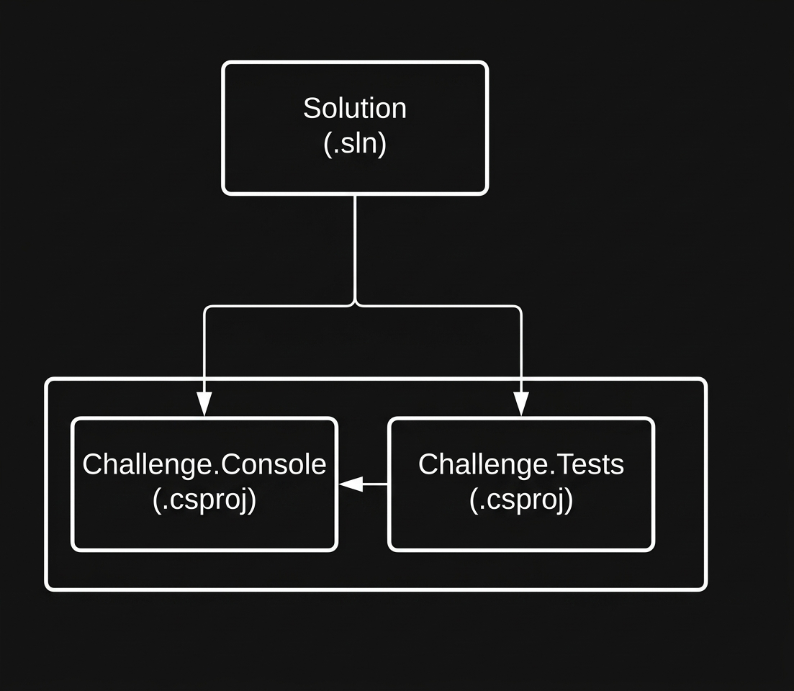

# Implementing Unit Test Validations with CSharp

Project developed during the WEX - .NET Development and QA bootcamp, under the guidance of expert [Leonardo Buta](https://github.com/leonardo-buta "Leonardo Buta").

## Context

A production system has been experiencing recurrent software stability issues, including regressions, validation bugs, and unexpected feature failures. To mitigate these anomalies and establish structural testability controls, a robust automated unit testing layer was integrated using xUnit.

## Premises

The system is structured into two main components: a console application containing core business logic and an independent xUnit testing project. The console application encapsulates its operations within two service boundaries: **ListValidations** and **StringValidations**.

The testing framework targets these layers explicitly through automated test suites designed to cover structural edge cases, negative boundaries, and positive execution paths.

## Console Project, Classes, and Methods

These are the core classes of the console application where the primary systems logic resides:

### ListValidations Class

Responsible for processing various operational validations involving arrays and integer collections.

| Class | Method | Objective |
| :--- | :--- | :--- |
| ListValidations | RemoveNegativeNumbers | Receives an integer list and returns a new collection containing exclusively positive numbers. |
| ListValidations | ListContainsSpecificNumber | Receives an integer list and verifies whether a specified number exists within the collection. |
| ListValidations | MultiplyListNumbers | Receives an integer list and returns a new collection with all elements multiplied by a specified factor. |
| ListValidations | ReturnLargestNumberList | Receives an integer list and returns the highest numeric value found within the collection. |
| ListValidations | ReturnSmallestNumberList | Receives an integer list and returns the lowest numeric value found within the collection. |

### StringValidations Class

Responsible for evaluating operations and constraints involving text inputs and string manipulation.

| Class | Method | Objective |
| :--- | :--- | :--- |
| StringValidations | ReturnCharacterCount | Receives a text input and returns the total number of characters present. |
| StringValidations | ContainsCharacter | Receives a text input and a target substring, returning true or false if the target is found. |
| StringValidations | TextEndsWith | Receives a text input and a target substring, returning true or false if the text terminates with the target. |

## Test Project, Suites, and Expected Outcomes

These are the automated testing suites implemented using xUnit to enforce code quality and runtime predictability:

### ListValidationsTests Suite

Validates the structural consistency of the operations performed on array collections.

| Class | Test Method | Expected Outcome |
| :--- | :--- | :--- |
| ListValidationsTests | ShouldRemoveNegativeNumbersFromAList | When provided an array containing positive and negative values, it must return a filtered list with positive integers only. |
| ListValidationsTests | ShouldFindNumber9InList | When provided an array containing the number 9, it must return true, confirming the value exists. |
| ListValidationsTests | ShouldNotFindNumber10InList | When provided an array that lacks the number 10, it must return false, confirming the value is missing. |
| ListValidationsTests | ShouldMultiplyListElementsBy2 | When provided an array of integers, it must yield a new array where every element is accurately multiplied by 2. |
| ListValidationsTests | ShouldReturn9AsLargestNumberInList | When provided an array where 9 is the highest element, it must accurately identify and return 9. |
| ListValidationsTests | ShouldReturnNegativeEightAsSmallestNumberInList | When provided an array where -8 is the lowest element, it must accurately identify and return -8. |

### StringValidationsTests Suite

Validates boundary criteria, existence checks, and termination predicates on string instances.

| Class | Test Method | Expected Outcome |
| :--- | :--- | :--- |
| StringValidationsTests | ShouldReturnCountOf6ForWordMatrix | When passed the text string "Matrix", it must return the integer value 6, matching the string length. |
| StringValidationsTests | ShouldFindTheWordQualquerInText | When supplied with the sentence "Esse é um texto qualquer" and searching for "qualquer", it must evaluate to true. |
| StringValidationsTests | ShouldNotFindTheWordTesteInText | When supplied with the sentence "Esse é um texto qualquer" and searching for "teste", it must evaluate to false. |
| StringValidationsTests | TextShouldEndWithSearchedWord | When supplied with the sentence "Começo, meio e fim do texto procurado" and searching for "procurado", it must evaluate to true. |

## Technical Stack & Execution

This project is built using:

* **.NET 6.0 Runtime**
* **xUnit Testing Framework**
* **Coverlet Collector** (for code coverage)

To execute all tests via CLI, navigate to the solution root folder and run:

```bash
dotnet test
```

## Project structure

The project is structured as follows:



## Solution

The test code is currently incomplete; you will need to continue by implementing the tests described above, ensuring that, in the end, we have a functional test program. Look for the commented-out word "TODO" in the code, then implement the required logic according to the rules provided above.

See [original repository](https://github.com/digitalinnovationone/trilha-net-testes-unitarios-desafio).

[LICENSE](/LICENSE)
