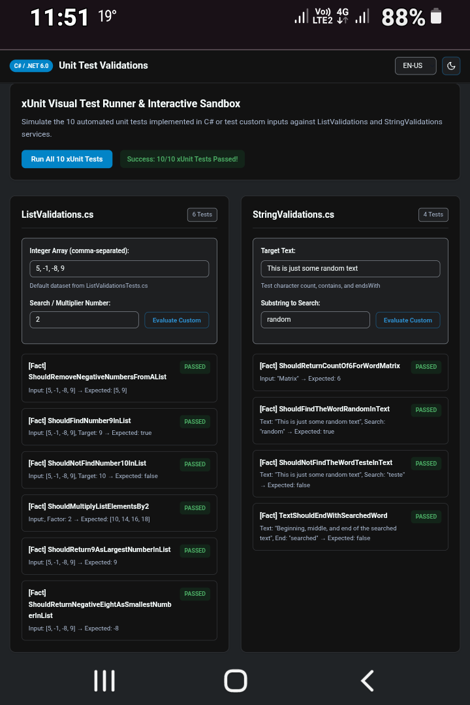

# Implementing Unit Test Validations with C# (Full-Stack Showcase)

This project combines a robust **C# / .NET 6.0** backend tested with **xUnit** and an interactive, responsive **HTML5, CSS3, and JavaScript** front-end showcase. Built during the WEX - .NET Development and QA bootcamp (mentored by [Leonardo Buta](https://github.com/leonardo-buta "Leonardo Buta")), the web interface visually simulates the unit test validations of the `ListValidations` and `StringValidations` services.

## Features

- **Interactive Test Runner**: Execute simulated xUnit assertions directly in the browser or test custom inputs against the C# business rules.
- **Theme Switcher**: Accessible Dark Mode (default) and Light Mode toggle with dynamic moon/sun icons and `localStorage` persistence.
- **Multi-Language Support (i18n)**: Instant UI translation between **English (EN-US - Default)**, **Portuguese (PT-BR)**, and **Spanish (ES-ES)**.
- **Responsive & Accessible**: Semantic HTML5 landmarks, ARIA live regions for screen readers, and fluid CSS Grid/Flexbox layouts for desktop, tablet, and smartphone screens.

## Tech Stack

### Backend & Quality Assurance

- **Core**: C# with .NET 6.0
- **Testing & Coverage**: xUnit and Coverlet

### Frontend & UI

- **HTML5**: Semantic structure focused on SEO and web accessibility
- **CSS3**: Modern responsive design using Custom Properties, Grid, Flexbox, and Dark/Light theme support
- **JavaScript (ES6+)**: Vanilla JS handling DOM state, mirrored backend validation logic, and multi-language (i18n) dictionaries

## How to Run

1. **Backend Tests (.NET CLI)**:

   ```bash
   dotnet test
   ```

2. **Frontend Showcase**:
   Open `index.html` directly in any modern web browser or serve it using VS Code Live Server.



[LICENSE](./LICENSE)
